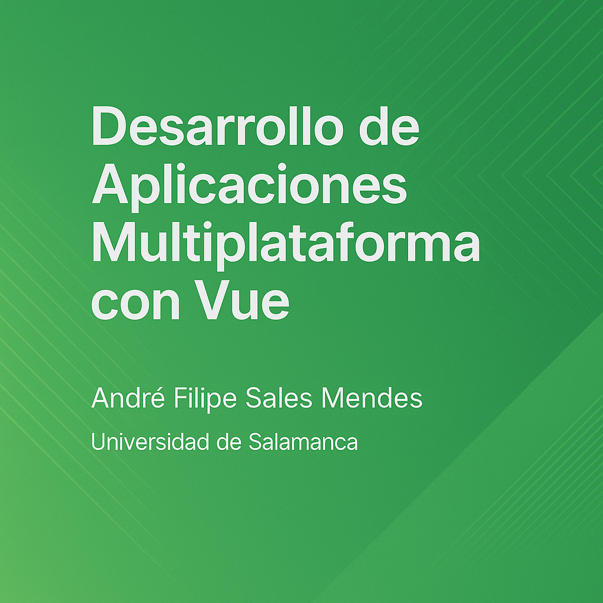

# Desarrollo de Aplicaciones Multiplataforma con Vue

[](https://doi.org/10.5281/zenodo.23451116)

<p align="center">
  
</p>

Material de la parte de desarrollo de aplicaciones multiplataforma con **Vue 3** de la asignatura *Desarrollo de Aplicaciones Avanzadas*, optativa de cuarto curso del Grado en Ingeniería Informática de la Universidad de Salamanca.

📖 **Leer el libro:** https://salesmendesandre.github.io/daa_vue/main/intro.html

## Código de los ejemplos

Este repositorio contiene **solo el texto del libro**. Todos los proyectos de ejemplo que se desarrollan capítulo a capítulo están en un repositorio aparte:

👉 **[salesmendesandre/daa_vue_examples](https://github.com/salesmendesandre/daa_vue_examples)** · DOI: [10.5281/zenodo.23451114](https://doi.org/10.5281/zenodo.23451114)

Cada fragmento de código del libro termina con un enlace `Fuente:` que apunta al archivo correspondiente de ese repositorio. Para trabajar con los ejemplos:

```bash
git clone https://github.com/salesmendesandre/daa_vue_examples.git
cd daa_vue_examples/01_introduction
npm install
npm run dev
```

Consulta el [README del repositorio de ejemplos](https://github.com/salesmendesandre/daa_vue_examples#readme) para ver qué carpeta corresponde a cada capítulo y qué requisitos tiene cada una (MongoDB, Firebase, variables de entorno…).

## Contenido

| Parte | Capítulos | Ejemplos |
| --- | --- | --- |
| Requisitos previos | 0. Requisitos previos | `00_prerequisites` |
| I – Fundamentos de Vue.js | 1. Introducción a Vue.js · 2. Configuración y componentes · 3. Interpolación, directivas y slots | `01`–`03` |
| II – Mecanismos reactivos y ciclo de vida | 4. Options API vs Composition API · 5. Ciclo de vida, reactividad y optimización · 6. Manejo de formularios | `04`–`06` |
| III – Ecosistema y PrimeVue | 7. Ruteo y estado global (Vue Router + Pinia) · 8. PrimeVue · 9. Formularios con PrimeVue Forms | `07`–`09` |
| IV – Firebase como backend | 10. Autenticación · 11. CRUD en Firestore · 12. Imágenes en Base64 · 13. Reglas de seguridad | `10`–`12` |
| V – Despliegue | 14. Build y despliegue (Firebase Hosting y GitHub Pages) | — |
| VI – APIs con Node.js y Express | 15. Node.js y Express · 16. API REST · 17. MongoDB y Mongoose · 18. Autenticación con JWT · 19. Subida de imágenes con Multer | `15`–`19` |

## Compilar el libro en local

El libro está hecho con [TeachBooks](https://teachbooks.io/) (Jupyter Book + Sphinx). Necesitas Python 3.10 o superior.

```bash
python -m venv .venv
source .venv/bin/activate        # En Windows: .venv\Scripts\activate
python -m pip install -r requirements-dev.txt
python scripts/live_book.py --open-browser
```

`live_book.py` recompila el libro cada vez que cambia algo en `book/` y lo sirve en `http://127.0.0.1:8000/` (se puede cambiar con `--host` y `--port`). Para una compilación única:

```bash
teachbooks build book
```

El HTML generado queda en `book/_build/html`.

## Estructura del repositorio

```
book/
├── _config.yml      # Configuración de TeachBooks / Jupyter Book
├── _toc.yml         # Índice: partes y capítulos
├── intro.md         # Página de inicio
├── vue/             # Un archivo Markdown por capítulo (pXcY_*.md)
└── figures/         # Imágenes, portada y favicon
scripts/live_book.py # Servidor local con recarga automática
```

## Publicación

El workflow [`call-deploy-book.yml`](.github/workflows/call-deploy-book.yml) compila y publica el libro en GitHub Pages en cada push que modifique `book/`. La rama `main` se publica en https://salesmendesandre.github.io/daa_vue/main/.

## Contribuir

Las erratas y sugerencias son bienvenidas: abre un [issue](https://github.com/salesmendesandre/daa_vue/issues) o usa el botón de edición de cualquier página del libro para proponer un cambio. Los fallos en el código de los ejemplos van al [repositorio de ejemplos](https://github.com/salesmendesandre/daa_vue_examples/issues).

## Cómo citar

Si utilizas este libro, cítalo así:

> Sales Mendes, A. F. (2026). *Desarrollo de Aplicaciones Multiplataforma con Vue*. Universidad de Salamanca. Zenodo. https://doi.org/10.5281/zenodo.23451116

El DOI [10.5281/zenodo.23451116](https://doi.org/10.5281/zenodo.23451116) apunta siempre a la última versión; en [Zenodo](https://doi.org/10.5281/zenodo.23451116) tienes el DOI de cada versión concreta. Los metadatos completos están en [`CITATION.cff`](CITATION.cff) (botón *Cite this repository* de GitHub).

## Licencia

El contenido del libro se publica bajo licencia [CC BY 4.0](LICENSE).

Queda excluido de esta licencia el logotipo de Vue.js usado como favicon (`book/figures/Vue_favicon.ico`), obra de Evan You distribuida bajo [CC BY-NC-SA 4.0](https://github.com/vuejs/art), que permite expresamente su uso en libros con fines educativos.

**Autor:** André Filipe Sales Mendes — Universidad de Salamanca
